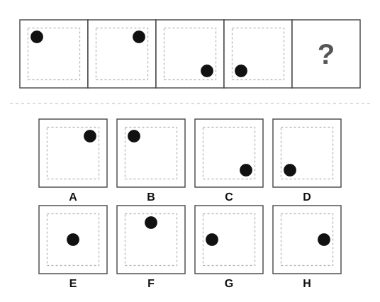
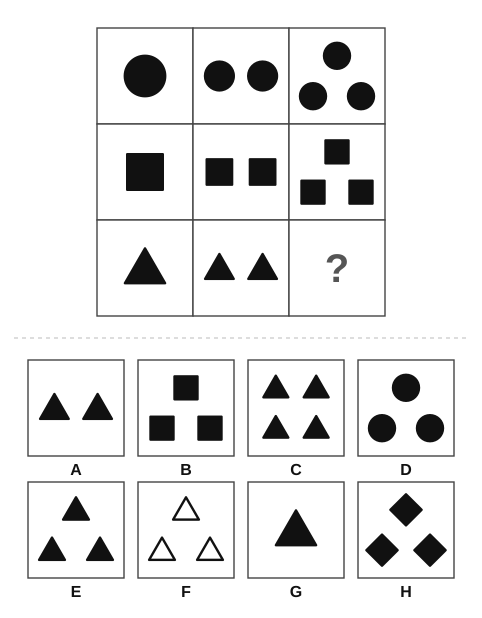

<!-- nav:top -->[Inhoud](../README.md#inhoud) · Vorige: [Wat is een capaciteitentest?](test-overview.md) · Volgende: [Woordrelaties](sections/woordrelaties.md)<!-- /nav:top -->

# Diagnostische toets van 15 minuten

Tien opgaven die we zelf hebben geschreven, twee per onderdeel, om te zien waar je moet beginnen. Zet een timer op 12 minuten, maak alles zonder rekenmachine en zonder iets op te zoeken (pen en kladpapier mag), kijk daarna je antwoorden na en lees de tabel onderaan. De laatste drie minuten zijn voor het nakijken.

Deze opgaven zijn zelf geschreven voor deze gids. Ze komen niet uit een echte capaciteitentest of uit materiaal van een testuitgever.

Ken je de vraagtypen al? Sla dit dan over en doe meteen de [gratis capaciteitentest op PrepClubs](https://prepclubs.com/nl/capaciteitentest-oefenen?utm_source=github&utm_medium=referral&utm_campaign=study-notes&utm_content=capaciteitentest). Een volledige getimede test zegt meer over je tempo.

## Deel A: Woordrelaties

**D1.** Vis staat tot kieuwen als mens staat tot ...

A. huid · B. longen · C. bloed · D. lucht · E. hart

**D2.** Welk woord is het tegenovergestelde van *tijdelijk*?

A. kortstondig · B. vroeg · C. blijvend · D. tijdig · E. langzaam

## Deel B: Tekstbegrip

Lees de tekst. Kies bij elke bewering **Juist** (volgt uit de tekst), **Onjuist** (is in strijd met de tekst) of **Niet te zeggen** (de tekst geeft geen uitsluitsel).

> Sinds 1 januari rijden medewerkers van het Westland Ziekenhuis de parkeergarage in met hun personeelspas. Bezoekers trekken nog steeds een kaartje bij de slagboom. Sinds die datum staan er 's ochtends minder auto's in de rij voor de garage.

**D3.** Bezoekers hebben sinds 1 januari een pas nodig om de parkeergarage in te rijden.

**D4.** De rij is korter geworden omdat medewerkers met hun pas sneller binnen zijn dan met een kaartje.

## Deel C: Cijfer- en letterreeksen

Welk getal of welke letter komt op de plaats van het vraagteken?

**D5.** 5, 10, 8, 16, 14, ?

A. 26 · B. 30 · C. 12 · D. 28 · E. 32

**D6.** A, Z, B, Y, C, ?

A. W · B. D · C. X · D. Y · E. V

## Deel D: Rekenvragen

**D7.** Een watertank van 60 liter is voor 40 procent gevuld. Hoeveel liter moet erbij om de tank helemaal vol te maken?

A. 36 · B. 24 · C. 40 · D. 20 · E. 30

**D8.** Acht machines maken samen 480 onderdelen in 6 uur. Hoeveel onderdelen maken vier van die machines in 9 uur, als ze even snel werken?

A. 240 · B. 320 · C. 480 · D. 360 · E. 720

## Deel E: Figuurreeksen en matrices

**D9.** Welke figuur hoort op de plaats van het vraagteken?

**D10.** Welke figuur hoort op de plaats van het vraagteken?

Antwoorden en uitleg, D1 tot en met D10

**D1: B, longen.** Een vis ademt met kieuwen, een mens met longen. Het verband is "ademt met". *Waarom niet D:* lucht is wat je inademt, niet het orgaan waarmee je ademt. Bij een vis zou dat water zijn.

**D2: C, blijvend.** Tijdelijk betekent "voor een tijd", het tegendeel is "voor altijd": blijvend. *Waarom niet A:* kortstondig betekent bijna hetzelfde als tijdelijk.

**D3: Onjuist.** De tekst zegt dat bezoekers nog steeds een kaartje trekken. De pas is alleen voor medewerkers.

**D4: Niet te zeggen.** De rij is korter sinds de pas er is, maar de tekst zegt niet waardoor. Misschien rijden er minder medewerkers met de auto, of komen ze op een ander tijdstip. Dat twee dingen tegelijk gebeuren, bewijst niet dat het een het ander veroorzaakt.

**D5: D, 28.** De stappen wisselen af: ×2, −2, ×2, −2. Na 14 is het weer ×2: 14 × 2 = 28. *Waarom niet C:* 12 gebruikt −2, maar −2 was de vorige stap.

**D6: C, X.** Twee reeksen door elkaar. Op de plaatsen 1, 3 en 5 loopt het alfabet vooruit: A, B, C. Op de plaatsen 2, 4 en 6 loopt het achteruit vanaf het eind: Z, Y, X. Het vraagteken staat op plaats 6. *Waarom niet B:* D is de volgende letter van de eerste reeks, maar die is pas op plaats 7 aan de beurt.

**D7: A, 36.** De tank is voor 40 procent vol, dus 60 procent is leeg. 10 procent van 60 is 6, dus 60 procent is 36 liter. *Waarom niet B:* 24 liter zit er al in.

**D8: D, 360.** Eén machine maakt 480 ÷ 8 = 60 onderdelen in 6 uur, dus 10 per uur. Vier machines maken samen 40 per uur, en in 9 uur 360. *Waarom niet A:* 240 is de helft van 480, maar dan vergeet je dat de machines langer draaien.

**D9: B.** De stip gaat elke stap met de klok mee naar de volgende hoek: linksboven, rechtsboven, rechtsonder, linksonder. De volgende hoek is weer linksboven, en dat is optie B.

**D10: E.** Per rij is de vorm steeds dezelfde (rondjes, vierkanten, driehoeken), en per kolom stijgt het aantal: 1, 2, 3. Rechtsonder horen dus drie zwarte driehoeken, en dat is optie E. *Waarom niet F:* daar zijn de driehoeken wit, terwijl alle figuren in het raster zwart zijn.

## Wat je uitslag betekent

Tel per deel hoeveel je goed had.

| Deel | Jouw score | Bij 0 goed | Bij 1 goed | Bij 2 goed |
|---|---|---|---|---|
| A. Woordrelaties | /2 | Begin met [woordrelaties](sections/woordrelaties.md) | Leer de lijst met soorten verbanden | Alleen kort herhalen |
| B. Tekstbegrip | /2 | Begin met [tekstbegrip](sections/tekstbegrip.md) | Oefen het verschil tussen Onjuist en Niet te zeggen | Alleen kort herhalen |
| C. Reeksen | /2 | Begin met [cijfer- en letterreeksen](sections/cijferreeksen.md) | Leer de volgorde van de aanpak uit je hoofd | Alleen kort herhalen |
| D. Rekenen | /2 | Begin met [rekenvragen](sections/rekenvragen.md) | Oefen procenten via 10 procent | Alleen kort herhalen |
| E. Figuren | /2 | Begin met [figuurreeksen en matrices](sections/figuurreeksen.md) | Leer de checklist met veranderingen | Alleen kort herhalen |

Kies daarna een plan: het [plan van 7 dagen](study-plans.md#plan-van-7-dagen) als je een week hebt, of het [plan van 2 dagen](study-plans.md#plan-van-2-dagen) als de test dichtbij is.

---

<!-- nav:bottom -->← Vorige: [Wat is een capaciteitentest?](test-overview.md) | Volgende: [Woordrelaties](sections/woordrelaties.md) → | [Terug naar de inhoud](../README.md#inhoud)<!-- /nav:bottom -->
