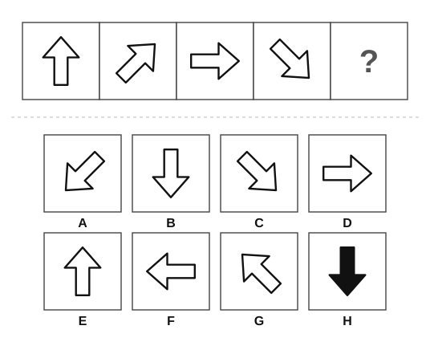
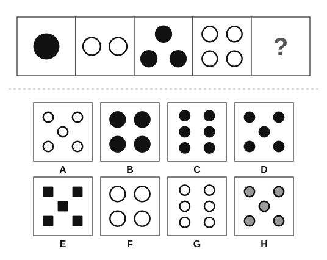
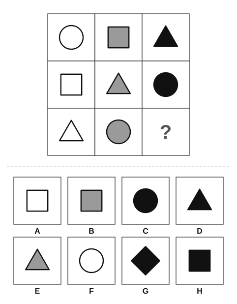
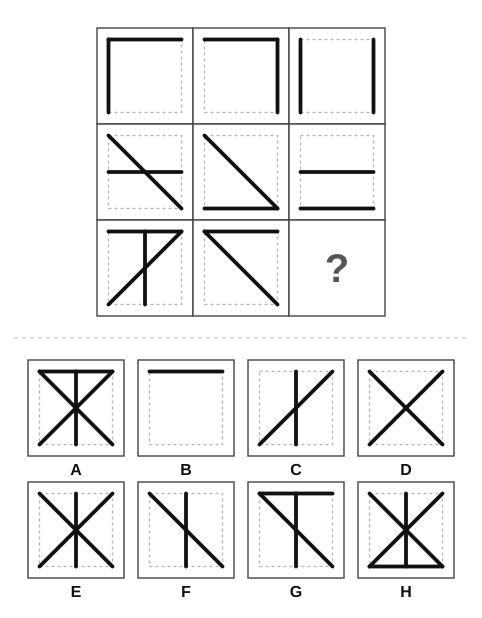

<!-- nav:top -->
[Inhoud](../../README.md#inhoud) · Vorige: [Rekenvragen](rekenvragen.md) · Volgende: [Zo werkt de score](../scoring.md)
<!-- /nav:top -->

# Figuurreeksen en matrices

**In één zin:** je ziet een rij of een raster van figuren die volgens een regel veranderen, en je kiest de figuur die op de plaats van het vraagteken hoort.

Dit is het non-verbale deel dat in veel capaciteitentests zit, al heeft niet elke test het (de cognitietest van de politie bijvoorbeeld niet). Defensie noemt het non-verbale vaardigheden, Ixly heeft Abstract Reasoning en noemt figurenreeksen "een veel voorkomend onderdeel" van een selectieassessment, en NOA heeft in de MCT-H onder meer "logisch nadenken met plaatjes". Omdat er geen taal en geen rekenwerk in zit, is dit voor veel mensen het onderdeel waar oefenen het snelst iets oplevert: het aantal soorten regels is beperkt.

## Wat het meet

Of je een regel kunt ontdekken in figuren die zelf niets betekenen. NOA beschrijft het als het vermogen om verbanden tussen figuren te zien, oftewel logisch redeneren met abstracte informatie. Je hebt er geen voorkennis voor nodig, alleen een systematische manier van kijken.

## Hoe de vragen eruitzien

Twee vormen komen het meest voor:

- **Figuurreeks:** een rij van vier of vijf vakjes, waarbij elke stap iets verandert. Je kiest het volgende vakje.
- **Matrix:** een raster van 3 bij 3 met het laatste vakje leeg. De regel loopt over de rijen, over de kolommen, of over allebei.

Je kiest uit een aantal opties, vaak zes tot acht. De opties lijken expres veel op elkaar: meestal verschilt een fout antwoord maar op één punt van het goede.

## Een aanpak die werkt

1. **Kijk naar wat verandert, niet naar wat er staat.** Vergelijk twee vakjes naast elkaar en benoem het verschil in woorden: "de pijl draait een achtste slag", "er komt een stip bij".
2. **Loop de checklist af.** Bijna elke regel valt onder een van deze veranderingen:

   | Wat kan veranderen | Voorbeeld |
   |---|---|
   | Aantal | 1, 2, 3, 4 stippen |
   | Draaiing | een pijl draait 45 of 90 graden per stap |
   | Positie | een stip loopt langs de hoeken |
   | Vulling | wit, grijs, zwart, of afwisselend |
   | Vorm | rondje, vierkant, driehoek |
   | Optellen en wegstrepen | lijnen uit twee vakjes samen, of alleen de lijnen die niet in beide staan |
   | Verdeling over een rij | elke vorm komt één keer voor in elke rij |

3. **Zoek alle regels, niet alleen de eerste.** Vaak lopen er twee regels tegelijk, bijvoorbeeld het aantal en de vulling. Een optie die maar één regel volgt, is een typisch fout antwoord.
4. **Bij een matrix: test rijen én kolommen.** Bepaal of de regel van links naar rechts loopt, van boven naar beneden, of allebei. Controleer je regel op de eerste twee rijen voordat je hem op de derde toepast.
5. **Voorspel eerst, kijk dan pas naar de opties.** Beschrijf voor jezelf hoe het ontbrekende vakje eruit moet zien. Dan laat je je minder afleiden door opties die er "ongeveer goed" uitzien.
6. **Schrap opties per regel.** Wie de vulling fout heeft, valt af. Wie het aantal fout heeft, valt af. Wat overblijft, is je antwoord.

## Valkuilen die punten kosten

- **Maar één regel zien.** Je ziet dat het aantal stippen oploopt, kiest vijf stippen en mist dat de vulling afwisselt.
- **Draairichting omkeren.** Bij een draaiende figuur kiezen mensen vaak de stand die één stap terug ligt. Kijk welke kant hij op draait.
- **Optellen en wegstrepen verwarren.** Als een lijn die in beide vakjes staat in het derde vakje juist verdwijnt, is het wegstrepen, geen optellen. Controleer dat op een rij waarin een lijn in beide vakjes voorkomt.
- **Alleen de rij bekijken bij een matrix.** Soms zit de regel in de kolommen. Een raster heeft altijd twee richtingen om te controleren.
- **Te lang staren.** Vind je na de checklist geen regel, schrap dan wat je kunt en gok uit de rest.

## Tempo

Als richtlijn: 30 tot 60 seconden per figuur. Eenvoudige reeksen met één regel gaan sneller, matrices met twee regels duren langer. De checklist hierboven helpt vooral om niet doelloos te kijken: loop hem van boven naar beneden af en stop zodra je een regel hebt die op alle vakjes past.

## Oefenopgaven

Deze 4 opgaven zijn zelf geschreven en getekend voor deze gids. Ze komen niet uit een echte capaciteitentest of uit materiaal van een uitgever. Welke figuur hoort op de plaats van het vraagteken?

**Opgave 1.**

**Opgave 2.**

**Opgave 3.**

**Opgave 4.**

Antwoorden en uitleg, opgaven 1 tot en met 4

**Opgave 1: B.** De pijl draait elke stap 45 graden met de klok mee: omhoog, schuin rechtsboven, rechts, schuin rechtsonder. De volgende stand is recht naar beneden, en de pijl blijft wit. Dat is optie B. *Waarom niet H:* die wijst ook naar beneden, maar is zwart, terwijl alle pijlen in de reeks wit zijn. *Waarom niet C:* die staat schuin rechtsonder, dat is de vorige stap.

**Opgave 2: D.** Twee regels tegelijk. Het aantal rondjes stijgt elke stap met één (1, 2, 3, 4), en de vulling wisselt af: zwart, wit, zwart, wit. Het vijfde vakje heeft dus vijf zwarte rondjes. Dat is optie D. *Waarom niet A:* vijf rondjes, maar wit. Die volgt alleen de regel voor het aantal. *Waarom niet E:* vijf zwarte figuren, maar vierkantjes in plaats van rondjes.

**Opgave 3: H.** Twee regels. In elke rij komen een rondje, een vierkant en een driehoek elk één keer voor. En de vulling hoort bij de kolom: de eerste kolom is wit, de tweede grijs, de derde zwart. In de derde rij ontbreekt nog het vierkant, en het staat in de derde kolom, dus zwart. Dat is optie H. *Waarom niet A of B:* wel een vierkant, maar wit of grijs. *Waarom niet C of D:* wel zwart, maar een rondje of driehoek, en die staan al in de derde rij.

**Opgave 4: E.** Het derde vakje van elke rij bevat de lijnen die in precies één van de eerste twee vakjes staan. Lijnen die in allebei staan, vallen weg. Rij 1: bovenkant en links, plus bovenkant en rechts, geeft links en rechts (de bovenkant valt weg). Rij 2: de diagonaal staat in beide en valt weg. Rij 3: links staan de verticale middenlijn, de bovenkant en de diagonaal van linksonder naar rechtsboven, in het midden de bovenkant en de diagonaal van linksboven naar rechtsonder. De bovenkant valt weg, dus blijven over: de verticale middenlijn en beide diagonalen. Dat is optie E. *Waarom niet A:* daar staat de bovenkant er nog bij. Dat is optellen, maar rij 1 en 2 laten zien dat gedeelde lijnen verdwijnen. *Waarom niet D:* daar ontbreekt de verticale middenlijn.

Meer oefenen? De gratis getimede capaciteitentest op PrepClubs heeft 30 vragen in 35 minuten, verdeeld over verbaal, numeriek en abstract: [capaciteitentest oefenen op PrepClubs](https://prepclubs.com/nl/capaciteitentest-oefenen?utm_source=github&utm_medium=referral&utm_campaign=uedrfa&utm_content=capaciteitentest).

## Je score

| Opgave | 1 | 2 | 3 | 4 |
|---|---|---|---|---|
| Antwoord | B | D | H | E |

- **4 goed:** je ziet regels snel. Houd dat vast met een getimede run en besteed de rest van je tijd aan de verbale onderdelen.
- **3 goed:** kijk of je een tweede regel miste (opgave 2 en 3) of optellen met wegstrepen verwarde (opgave 4). Zet dat op je foutenlijst.
- **2 of minder:** loop bij elke figuur de checklist uit stap 2 hardop af en schrijf de regels op voordat je naar de opties kijkt. Na een paar dagen gaat dat vanzelf.

## Volgende stap

Figuren onder tijdsdruk zijn een kwestie van routine. Oefen ze gemengd met verbale en numerieke vragen in de [gratis capaciteitentest op PrepClubs](https://prepclubs.com/nl/capaciteitentest-oefenen?utm_source=github&utm_medium=referral&utm_campaign=uedrfa&utm_content=capaciteitentest), en houd bij welke soort verandering je het vaakst mist.

---

<!-- nav:bottom -->
← Vorige: [Rekenvragen](rekenvragen.md) | Volgende: [Zo werkt de score](../scoring.md) → | [Terug naar de inhoud](../../README.md#inhoud)
<!-- /nav:bottom -->
